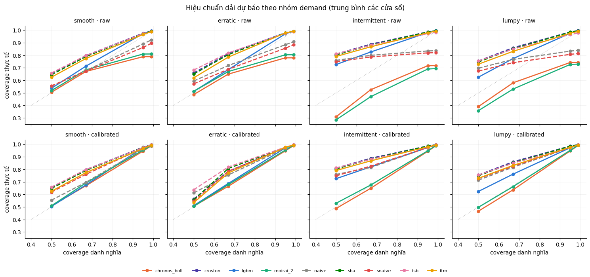

# Báo cáo P5 — Hiệu chuẩn, đánh giá và kiểm định (Bước 6 · 7 · 8)

*Cập nhật 07/10/2026 · nhánh `p5-evaluation` (commit `50b59a2`) · notebook `notebooks/P5.ipynb`*
*Bản chính thức: đủ **9 model × 3.474 chuỗi × 3 cửa sổ**, hiệu chuẩn bằng forecast validation của P3/P4.*

> **Tóm tắt.**
> - **LightGBM (global quantile) là model tốt nhất tổng thể.** Ở cả bản raw lẫn calibrated, nó có RMSSE thấp nhất ở smooth, intermittent và lumpy, và WSPL thấp nhất ở 3 nhóm này.
> - **Erratic là nhóm duy nhất Moirai-2 nhỉnh hơn**, nhưng chênh với LightGBM không có ý nghĩa thống kê.
> - **Theo win rule (≥ 3 cửa sổ + kiểm định DM), chỉ một ô "thắng rõ" ở tiêu chí chính WSPL calibrated:** LightGBM ở **smooth**. Các nhóm còn lại là "tương đương" nên khuyến nghị lấy model rẻ nhất trong nhóm tương đương. Kết quả: erratic → SNaive, intermittent → Croston, lumpy → LightGBM. Lý do là kiểm định có trọng số $ thiếu lực (xem mục 4.3).
> - **Hiệu chuẩn conformal sửa được dải quá hẹp** của Chronos, Moirai, Naive và SNaive (coverage-95 từ 0.69–0.89 lên ~0.95–0.97).
> - **Cảnh báo lớn nhất:** 3 foundation model dự báo test ở **tầm 29–56 ngày** (context dừng ở `train_end`). Cổ điển và LightGBM dự báo ở tầm 1–28 ngày, nên FM đang bị thiệt khi so sánh.

---

## 0. Đầu vào thực tế

| Thành phần | Nguồn | Ghi chú |
|---|---|---|
| Actual + giá (`data_long`) | Dựng lại từ bản M5 công khai bằng đúng code P1 | Tỷ lệ zero khớp 100% với `segment_labels` của P1 |
| Mẫu | `common/sample_ids.csv` | 3.474 chuỗi: smooth 980 · erratic 494 · intermittent 1.000 · lumpy 1.000 |
| Cửa sổ | `common/rolling_windows.csv` | W1 test d1914–1941 · W2 d1886–1913 · W3 d1858–1885 |
| Forecast test | `data/outputs/forecasts/*.parquet` (main) | 9 model, cả 9 "đúng lưới" theo hợp đồng của P1 |
| Forecast validation | `data/outputs/forecasts/val/*.parquet` (main) | 9 model × 3 cửa sổ, dùng làm tập hiệu chuẩn |

**Gốc dự báo khác nhau giữa các họ.** Đọc code P3/P4 thì thấy:

| Họ | Dữ liệu dùng để dự báo test | Tầm dự báo test |
|---|---|---|
| Cổ điển (Naive, SNaive, Croston, SBA, TSB) | fit lại tới `test_start − 1` | 1–28 ngày |
| LightGBM | train ≤ `train_end`, feature lag ≥ 28 dùng actual tới `val_end` | tương đương 1–28 ngày |
| FM (Chronos, TTM, Moirai) | context ≤ `train_end`, dự báo 56 ngày: val = ngày 1–28, test = ngày 29–56 | **29–56 ngày** |

Hệ quả là FM không thấy 28 ngày ngay trước test. Ngoài ra, residual hiệu chuẩn của FM (ở tầm 1–28) "dễ" hơn test (tầm 29–56). **Mọi kết luận "FM thua LightGBM" cần đọc kèm điểm này**; muốn so công bằng thì P4 nên chạy lại với context ≤ `val_end`.

---

## 1. Bước 6 — Hiệu chuẩn chung (split-conformal)

**Vì sao cần:** mỗi họ vẽ dải một kiểu, nên chấm thẳng là chấm "lớp bọc" chứ không phải năng lực model:
- Chronos và Moirai ra quantile native nhưng **kẹp đuôi** trong [0.1, 0.9].
- LightGBM ra quantile bằng pinball loss.
- Cổ điển và TTM ra **điểm**, sau đó bọc thành phân phối Negative Binomial/Poisson.

**Cách làm** (cùng một thủ tục cho mọi model; thực hiện riêng cho mỗi model × cửa sổ × nhóm demand × mức quantile τ):
1. **Tập hiệu chuẩn** = forecast validation RAW của chính model đó cho cửa sổ đó (d ∈ (train_end, val_end]). Actual dùng để hiệu chuẩn đều ≤ gốc test, nên không rò rỉ.
2. **Residual chuẩn hoá:** `r = (y − q̂_τ) / s_i`, với `s_i` = MAE của naive-1 trên lịch sử chuỗi. Chuẩn hoá để chuỗi bán nhiều không lấn át chuỗi bán ít.
3. **Lượng dịch δ** = thống kê thứ tự `⌈(n+1)τ⌉` (khi τ ≥ 0.5) hoặc `⌊(n+1)τ⌋` (khi τ < 0.5) của r. Đây là công thức conformal, bảo đảm coverage hữu hạn mẫu.
4. **Quantile mới:** `q'_τ = max(0, q̂_τ + δ · s_i)`, rồi sắp lại 9 quantile cho khỏi chéo nhau.

"Mondrian theo nhóm" nghĩa là δ được tính riêng cho từng nhóm demand, để từng nhóm đều đúng coverage chứ không chỉ đúng ở mức trung bình.

---

## 2. Bước 7 — Metric

| Metric | Đo gì | Vai trò |
|---|---|---|
| **RMSSE** | Sai số bình phương của P50, chia cho naive-1 (chuẩn M5) | Điểm — chính |
| MASE | Sai số tuyệt đối của P50, chia cho naive-1 | Điểm — phụ |
| **WSPL** | Pinball loss trên 9 quantile, trọng số = doanh thu $ 28 ngày trước gốc | Xác suất — chính |
| SPL | Như WSPL nhưng không trọng số | Xác suất — phụ |
| **Coverage** 50/67/95/99 | Tỷ lệ ngày actual nằm trong dải | Hiệu chuẩn — chính |
| miss_lo95 / miss_hi95, width95, bias | Miss phía dưới / phía trên dải 95, độ rộng dải, độ lệch P50 | Chẩn đoán, error analysis |

Có hai cách gộp 4 nhóm:
- **Balanced** = 4 nhóm ngang nhau (góc khoa học).
- **Frequency-weighted** = trọng số theo tần suất thật trên 30.490 chuỗi: intermittent 75.7%, lumpy 19.4%, smooth 3.2%, erratic 1.6% (góc vận hành).

---

## 3. Kết quả (trung bình 3 cửa sổ; **in đậm** = tốt nhất cột)

### 3.1 RMSSE — độ chính xác điểm (raw)

| model | smooth | erratic | intermittent | lumpy | balanced | freq-weighted |
|---|---|---|---|---|---|---|
| **lgbm** | **0.746** | 0.695 | **0.803** | **0.725** | **0.742** | **0.785** |
| moirai_2 | 0.760 | **0.692** | 0.816 | 0.749 | 0.754 | 0.799 |
| chronos_bolt | 0.768 | 0.717 | 0.818 | 0.765 | 0.767 | 0.804 |
| ttm | 0.803 | 0.760 | 0.860 | 0.815 | 0.810 | 0.848 |
| croston | 0.765 | 0.725 | 0.851 | 0.798 | 0.785 | 0.836 |
| sba | 0.775 | 0.733 | 0.856 | 0.803 | 0.791 | 0.841 |
| tsb | 0.767 | 0.714 | 0.846 | 0.792 | 0.780 | 0.831 |
| snaive | 0.900 | 0.815 | 0.893 | 0.825 | 0.858 | 0.879 |
| naive | 0.940 | 0.822 | 0.887 | 0.819 | 0.867 | 0.875 |

### 3.2 WSPL — chất lượng dải (calibrated; bản raw ở cột cuối để so)

| model | smooth | erratic | intermittent | lumpy | balanced | freq-weighted | *raw balanced* |
|---|---|---|---|---|---|---|---|
| **lgbm** | **0.200** | 0.248 | **0.260** | **0.300** | **0.252** | **0.265** | *0.252* |
| moirai_2 | 0.210 | **0.241** | 0.284 | 0.306 | 0.260 | 0.285 | *0.283* |
| chronos_bolt | 0.211 | 0.254 | 0.300 | 0.330 | 0.274 | 0.302 | *0.299* |
| ttm | 0.224 | 0.307 | 0.331 | 0.375 | 0.309 | 0.335 | *0.310* |
| croston | 0.211 | 0.301 | 0.316 | 0.356 | 0.296 | 0.320 | *0.296* |
| sba | 0.211 | 0.298 | 0.316 | 0.355 | 0.295 | 0.320 | *0.295* |
| tsb | 0.216 | 0.305 | 0.318 | 0.362 | 0.300 | 0.323 | *0.299* |
| snaive | 0.254 | 0.340 | 0.374 | 0.413 | 0.345 | 0.377 | *0.384* |
| naive | 0.294 | 0.368 | 0.398 | 0.431 | 0.373 | 0.401 | *0.401* |

**Ổn định qua cửa sổ (WSPL calibrated):** LightGBM tốt nhất ở **cả 3 cửa sổ** của smooth và intermittent. Ở lumpy nó thắng W1–W2 nhưng thua Moirai ở W3 (0.306 so với 0.303). Ở erratic, Moirai tốt nhất ở cả 3 cửa sổ, nhưng LightGBM chỉ kém 0.002–0.014.

### 3.3 Coverage dải 95% (raw → calibrated)

*Hàng trên = raw, hàng dưới = calibrated. Đường chấm = hiệu chuẩn hoàn hảo; nằm dưới = dải quá hẹp (tự tin thừa).*

| model | smooth | erratic | intermittent | lumpy |
|---|---|---|---|---|
| lgbm | 0.97 → 0.97 | 0.97 → 0.97 | 0.98 → 0.97 | 0.98 → 0.97 |
| moirai_2 | **0.81 → 0.95** | **0.80 → 0.95** | **0.69 → 0.95** | **0.73 → 0.95** |
| chronos_bolt | **0.79 → 0.95** | **0.78 → 0.95** | **0.72 → 0.94** | **0.74 → 0.95** |
| ttm | 0.97 → 0.97 | 0.98 → 0.98 | 0.98 → 0.98 | 0.98 → 0.98 |
| croston / sba | 0.97–0.98 (không đổi) | 0.98 | 0.99 | 0.99 |
| tsb | 0.97 → 0.97 | 0.98 → 0.98 | 0.97 → 0.98 | 0.97 → 0.97 |
| snaive | **0.86 → 0.97** | **0.86 → 0.97** | **0.82 → 0.97** | **0.81 → 0.97** |
| naive | **0.89 → 0.96** | **0.88 → 0.97** | **0.84 → 0.97** | **0.83 → 0.97** |

Bốn quan sát chính:
1. **Bốn model dải quá hẹp đã được sửa:** Chronos, Moirai, Naive và SNaive. Chronos và Moirai miss *cả hai phía* (10–21% mỗi phía); Naive và SNaive chủ yếu miss *phía trên* (13–19%). Sau hiệu chuẩn, phía trên còn ~2.5–3%.
2. **Đuôi Chronos và Moirai bị kẹp, thấy rõ trên biểu đồ:** ở bản raw, coverage dải 99% bằng đúng coverage dải 95% (đường nằm ngang ở cuối). Conformal mở được đuôi ra.
3. **LightGBM, TTM và nhóm Croston/SBA/TSB vốn đã ~0.97–0.99**, nên conformal gần như không đổi gì.
   - Nguyên nhân: với dữ liệu đếm có sàn 0, khi P2.5 = 0 thì actual không thể rơi xuống dưới dải (miss_lo95 ≈ 0).
   - Vì thế coverage dải trung tâm hội tụ về ~0.975 chứ không phải 0.95. Đây là tính chất của dữ liệu gián đoạn, không phải lỗi hiệu chuẩn; phía trên (phía quyết định tồn kho) vẫn đúng mức danh nghĩa.
4. **Trên chuỗi nhiều số 0, dải 50% của mọi model trừ Chronos/Moirai chứa actual 73–81%.** Cũng do P25 = P75 = 0 trùng với các ngày bán 0.

### 3.4 Error analysis — bias của P50 (chuẩn hoá, âm = dự báo thấp; bản raw)

| model | smooth | erratic | intermittent | lumpy |
|---|---|---|---|---|
| lgbm | −0.23 | −0.22 | **−0.61** | **−0.39** |
| moirai_2 | −0.29 | −0.28 | −0.72 | −0.59 |
| chronos_bolt | −0.22 | −0.25 | −0.71 | −0.62 |
| ttm | −0.31 | −0.40 | −0.87 | −0.85 |
| croston / sba / tsb | −0.20 … −0.30 | −0.34 … −0.39 | −0.82 … −0.85 | −0.79 … −0.81 |
| naive | +0.04 | −0.17 | −0.63 | −0.70 |

- **Mọi model đều dự báo P50 thấp có hệ thống**, mạnh nhất ở intermittent và lumpy. Với chuỗi nhiều số 0, median tối ưu thường bằng 0, nên P50 bỏ lỡ các ngày có bán. Đây là lý do phải chấm **cả dải** chứ không chỉ P50.
- **LightGBM lệch ít nhất ở lumpy (−0.39)**, nhờ các feature lịch, giá và days-since-last-sale.
- **Croston/SBA/TSB và TTM lệch nhiều nhất**: point forecast phẳng, khi bọc NB thì median ra 0.

---

## 4. Bước 8 — Kiểm định & win rule

### 4.1 Cách làm
Đơn vị quan sát là một cặp (chuỗi, cửa sổ). Với mỗi tổ hợp (bản raw/calibrated × nhóm × metric):

- **Best** = model có metric tổng hợp thấp nhất.
- **Diebold–Mariano dạng panel:** lấy chênh loss so với best (với WSPL thì có trọng số $). Sai số chuẩn được **cluster theo chuỗi**, vì các cửa sổ của cùng một chuỗi không độc lập. Hiệu chỉnh **Holm** cho 8 phép so sánh.
- **MCB** (Multiple Comparison with the Best): dựa trên thứ hạng trung bình. Chỉ báo cáo để tham khảo vì:
  - nó xếp hạng **không trọng số**, nên không phản ánh WSPL;
  - nó bị nhiễu bởi rất nhiều hoà hạng (chuỗi mà mọi model đều dự báo 0).
- **Win rule** (đúng quy định nhóm "≥ 3 cửa sổ VÀ một kiểm định"):
  - Model *m* "thua rõ" khi best tốt hơn *m* ở **cả 3 cửa sổ** VÀ DM (Holm) có p < 0.05.
  - Best "**thắng rõ**" khi mọi model khác đều thua rõ.
  - Nếu không, nhãn là "**tương đương**" và khuyến nghị lấy model **rẻ nhất** trong nhóm tương đương. Thứ tự chi phí: naive/snaive < Croston/SBA/TSB < LightGBM < TTM < Chronos < Moirai.

### 4.2 Bảng quyết định (tiêu chí chính: WSPL calibrated) — `decision_table.parquet`

| Nhóm | Model tốt nhất | Á quân (chênh, p DM Holm) | Nhãn | Nhóm tương đương | **Khuyến nghị (theo luật)** | Theo RMSSE |
|---|---|---|---|---|---|---|
| smooth | lgbm | moirai_2 (+4.9%, p = 0.007) | **thắng rõ** | lgbm | **lgbm** | lgbm (thắng rõ) |
| erratic | moirai_2 | lgbm (+3.1%, p = 0.42) | tương đương | moirai_2, lgbm, sba, croston, tsb, ttm, snaive | **snaive** | tsb (tương đương) |
| intermittent | lgbm | moirai_2 (+9.4%, p = 0.16) | tương đương | lgbm, moirai_2, chronos, croston, sba, tsb, ttm | **croston** | lgbm (thắng rõ) |
| lumpy | lgbm | moirai_2 (+2.2%, p = 0.30) | tương đương | lgbm, moirai_2 | **lgbm** | lgbm (thắng rõ) |

Các nhãn "thắng rõ" khác, đều của **LightGBM**, đều qua cả 3 cửa sổ + DM:
- **RMSSE** ở smooth, intermittent, lumpy (cả raw lẫn calibrated);
- **MASE** ở smooth;
- **WSPL raw** ở smooth và lumpy;
- **SPL raw** ở smooth và lumpy.

### 4.3 Vì sao khuyến nghị ra SNaive (erratic) và Croston (intermittent)
Đây là hệ quả **cơ học** của luật, nhóm đã chọn giữ nguyên:

- **Ở erratic,** SNaive kém Moirai **41%** ở cả 3 cửa sổ, Croston/SBA/TSB kém ~24%. Nhưng DM có trọng số $ cho p ≥ 0.05, nên các model này vẫn bị tính "tương đương" và luật chi phí chọn SNaive.
- **Ở intermittent,** Croston kém LightGBM **22%** ở cả 3 cửa sổ (p = 0.12), nên luật chi phí chọn Croston.
- **Nguyên nhân: kiểm định thiếu lực vì trọng số $ dồn vào ít chuỗi.**

  | Nhóm | Số chuỗi | Cỡ mẫu hiệu dụng của WSPL | Top-10 chuỗi chiếm |
  |---|---|---|---|
  | erratic | 494 | ~96 | 19% trọng số |
  | lumpy | 1.000 | ~177 | 16% trọng số |
  | intermittent | 1.000 | ~294 | 11% trọng số |
  | smooth | 980 | ~444 | 7% trọng số |

- **Cách đọc đúng:** "chưa đủ bằng chứng thống kê (theo $) để nói LightGBM/Moirai hơn Croston/SNaive", **không phải** "Croston/SNaive tốt ngang". Theo ước lượng điểm và độ ổn định 3 cửa sổ, LightGBM (intermittent) và Moirai/LightGBM (erratic) tốt hơn rõ rệt.

---

## 5. Kết luận — "nhu cầu nào → model nào"

| Nhóm (tỷ trọng thật) | Theo luật đã chốt | Theo ước lượng điểm (ổn định 3 cửa sổ) | Ghi chú |
|---|---|---|---|
| **smooth** (3.2%) | **LightGBM — thắng rõ** | LightGBM | Thắng cả RMSSE lẫn WSPL; cổ điển và FM bám sát (+5%) |
| **erratic** (1.6%) | SNaive (tương đương, do chi phí) | Moirai-2 ≈ LightGBM | Nhóm duy nhất FM nhỉnh nhất; kiểm định thiếu lực (N hiệu dụng ~96) |
| **intermittent** (75.7%) | Croston (tương đương, do chi phí) | **LightGBM** (thắng rõ về RMSSE) | Chênh WSPL 9–22% so với các model khác nhưng chưa có ý nghĩa thống kê theo $ |
| **lumpy** (19.4%) | LightGBM (tương đương với Moirai) | LightGBM ≈ Moirai-2 | LightGBM thắng rõ về RMSSE |

**Các điểm chính:**
1. **Một model ML toàn cục (LightGBM) hợp với hầu hết các loại nhu cầu.** Nó tốt nhất hoặc ngang tốt nhất ở cả 4 nhóm, chính xác nhất về điểm, dải đã gần đúng mức ngay từ bản raw, và lệch ít nhất ở lumpy.
2. **Trái với kỳ vọng trong plan, Croston/SBA/TSB không vượt LightGBM ở intermittent/lumpy.** Họ Croston chỉ ngang ở smooth về WSPL và kém 18–22% ở intermittent/lumpy. Ưu điểm còn lại là rẻ — luật chi phí chọn Croston cho intermittent cũng vì lý do này.
3. **Moirai-2 là FM tốt nhất (Moirai > Chronos > TTM)** và bám sát LightGBM dù dự báo xa hơn 28 ngày. Nếu chạy lại FM với gốc `val_end`, kết luận về FM có thể thay đổi.
4. **Hiệu chuẩn là bước bắt buộc.** Dải thô của Chronos, Moirai, Naive và SNaive "tự tin sai" (dải 95% chỉ phủ 69–89%). Conformal sửa được về ~0.95–0.97 và cải thiện WSPL ~7–10% (balanced) cho các model này. Coverage xứng đáng là kết quả chính.
5. **Chọn metric làm đổi kết luận:** SPL (không trọng số) và WSPL ($) khác nhau rõ nhất ở erratic. Kết luận bám theo WSPL vì đã chốt trước khi xem kết quả.

**Hạn chế cần ghi vào báo cáo:**
- FM dự báo ở tầm 29–56 ngày (mục 0).
- Forecast validation của LightGBM cũng là tập early-stopping, nên residual hiệu chuẩn hơi lạc quan.
- DM coi các chuỗi độc lập với nhau.
- Kiểm định theo $ thiếu lực ở erratic/lumpy.
- Rủi ro FM đã thấy M5 khi pre-training.
- `data_long` do P5 dựng lại (khớp hoàn toàn với nhãn của P1).

---

## 6. Việc tiếp theo

| Ai | Việc |
|---|---|
| P2 | Bước 9: đọc `decision_table.parquet` (giữ tên cột cũ). Với `metrics_by_model_segment.parquet`, thêm `.query("version=='calibrated' and window=='ALL'")` trước khi merge, vì bảng có thêm cột `version` và `window`. |
| P4 (nếu kịp) | Chạy lại FM với context ≤ `val_end` (dự báo 28 ngày) để so công bằng; P5 chỉ cần chạy lại notebook. |
| P1 | Gộp phương pháp + kết quả P5 vào báo cáo (10a), kèm các hạn chế ở mục 5. |

**File output trong repo:**
- `data/outputs/metrics_by_model_segment.parquet` — metric theo bản × cửa sổ × model × nhóm, kèm 2 dòng ALL.
- `data/outputs/decision_table.parquet` — 1 dòng / nhóm.

Các bảng chi tiết (kiểm định từng cặp, metric theo chuỗi, offset hiệu chuẩn) hiển thị trong notebook, không lưu vào repo.
