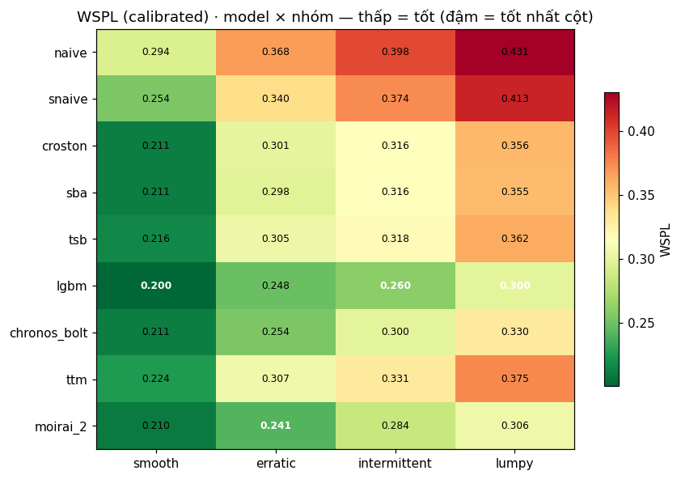
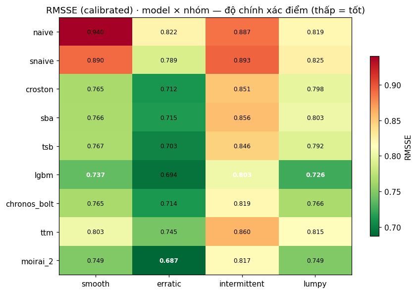
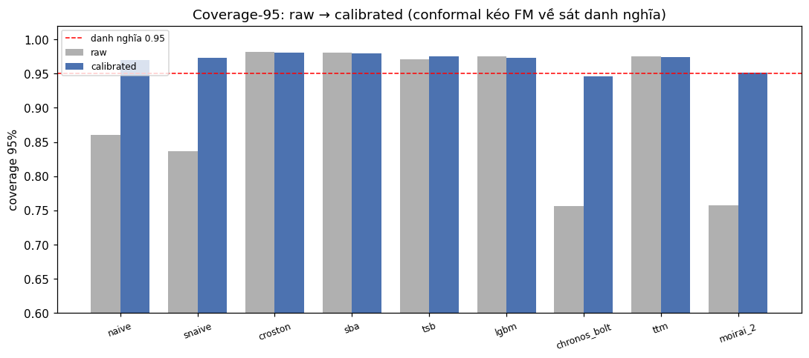

# Dự báo xác suất nhu cầu gián đoạn trong bán lẻ: So sánh Cổ điển · Machine Learning · Foundation Model, phân nhóm theo đặc tính nhu cầu

**Báo cáo tổng hợp (Bước 10a) — tích hợp P1–P5.** Dữ liệu: M5 Walmart. Mã nguồn & kết quả: repo nhóm.

---

## Tóm tắt (Abstract)

Chúng tôi so sánh ba họ mô hình — **cổ điển** (Naive, SeasonalNaive, Croston, SBA, TSB), **machine learning** (LightGBM quantile), và **foundation model** (Chronos-Bolt, TinyTimeMixer, Moirai-2) — cho **dự báo xác suất** nhu cầu bán lẻ trên tập M5, **phân nhóm theo đặc tính nhu cầu** (khung SBC). Đánh giá dùng **rolling-origin 3 cửa sổ**, **hiệu chuẩn split-conformal chung** để so sánh công bằng, và **kiểm định Diebold–Mariano + MCB** với quy tắc thắng khắt khe. Kết quả: trên tiêu chí chính **WSPL (đã hiệu chuẩn)**, **LightGBM đạt điểm thấp nhất toàn cục** (0.252 balanced / 0.265 frequency-weighted) và **thắng rõ ở nhóm `smooth`** (p = 0.007). Ở ba nhóm còn lại (`erratic`, `intermittent`, `lumpy`) nhiều mô hình **tương đương về thống kê** — khi đó khuyến nghị **mô hình đơn giản/rẻ** (SeasonalNaive, Croston). Hiệu chuẩn conformal **sửa được thiếu phủ đuôi** của FM (coverage-95 từ ~0.75 lên ~0.95). Kết luận cốt lõi: **không có mô hình thắng tuyệt đối; lựa chọn phụ thuộc nhóm nhu cầu và thường nằm trong sai số thống kê.**

---

## 1. Giới thiệu & câu hỏi nghiên cứu

Bán lẻ có đa số SKU bán **gián đoạn** (nhiều ngày = 0), khiến dự báo điểm kém ý nghĩa và đòi hỏi **dự báo xác suất** (khoảng/phân vị). Câu hỏi lõi của nghiên cứu:

> **"Nhu cầu nào → nên dùng mô hình nào?"** — và ưu thế (nếu có) của foundation model so với cổ điển/ML có **vững qua kiểm định** không?

Hai lựa chọn thiết kế xuyên suốt: (i) **dự báo xác suất** 9 mức phân vị `{0.005, 0.025, 0.165, 0.25, 0.5, 0.75, 0.835, 0.975, 0.995}` thay vì một điểm; (ii) **phân nhóm theo đặc tính nhu cầu** (SBC) để kết luận *có điều kiện* theo nhóm thay vì trung bình toàn tập.

---

## 2. Dữ liệu & phân nhóm (P1)

**Nguồn.** M5 Walmart: **30.490 chuỗi** (item × store) × **1.941 ngày**, kèm `calendar` (sự kiện/lễ, SNAP) và `sell_prices`. Chuẩn hoá về dạng **long** + ghép lịch/giá + feature nền (wday, month, is_event, SNAP, sell_price).

**Phân nhóm SBC (Syntetos–Boylan–Croston).** Mỗi chuỗi đặc trưng bởi **ADI** (khoảng cách trung bình giữa 2 lần bán) và **CV²** (biến động cỡ nhu cầu), tính **chỉ trên train** (chống rò rỉ). Ngưỡng ADI = 1,32; CV² = 0,49 → 4 nhóm:

**Bảng 1 — Phân bố nhóm demand (toàn bộ 30.490 chuỗi).**

| Nhóm | Số chuỗi | Tỷ lệ | zero_rate (TB) | ADI (median) | CV² (median) |
|---|---:|---:|---:|---:|---:|
| smooth | 980 | 3,21% | 0,138 | 1,18 | 0,37 |
| erratic | 494 | 1,62% | 0,167 | 1,22 | 0,61 |
| intermittent | 23.095 | 75,75% | 0,738 | 4,60 | 0,30 |
| lumpy | 5.921 | 19,42% | 0,604 | 2,50 | 0,62 |

**Nhận định quan trọng:** phân bố **cực kỳ mất cân bằng** — **95,17%** chuỗi thuộc hai nhóm *thưa* (intermittent + lumpy). Hệ quả: (i) ưu tiên metric xác suất; (ii) **đánh giá phải tách theo nhóm**; (iii) khi tổng hợp toàn tập cần **trọng số theo tần suất**.

**Lấy mẫu phân tầng.** Giữ **100% nhóm hiếm** (smooth 980, erratic 494) + **cap 1.000** mỗi nhóm phổ biến → **3.474 chuỗi** cân bằng để phân tích theo đặc tính (nhãn SBC vẫn sinh cho đủ 30.490 chuỗi phục vụ trọng số).

**Chia dữ liệu & rolling-origin (chống rò rỉ).** 3 cửa sổ trượt lùi 28 ngày, **mọi test ≤ d_1941** (phạm vi có actuals):

**Bảng 2 — Ba cửa sổ rolling-origin.**

| Cửa sổ | Train (≤) | Validation | Test |
|---|---:|---:|---:|
| W1 | d_1885 | d_1886–1913 | d_1914–1941 |
| W2 | d_1857 | d_1858–1885 | d_1886–1913 |
| W3 | d_1829 | d_1830–1857 | d_1858–1885 |

Kiểm chứng tự động (P1): train < test, test đúng 28 ngày, không chồng lấn, `data_long` đủ 3.474 chuỗi × 6.743.034 dòng, không trùng (series_id, d_int), cột khóa không NaN.

---

## 3. Đặc tính nhu cầu — EDA (P2)

- **Nhu cầu/ngày** giảm ~10 lần theo trục gián đoạn: smooth ≈ 7,0 và erratic ≈ 6,8 nhưng intermittent ≈ 0,63 và lumpy ≈ 1,58.
- **Mùa vụ tuần rõ:** cuối tuần (T7/CN) cao hơn ngày thường **~31%**; mùa vụ năm nhẹ (đỉnh tháng 8, đáy tháng 1) → biện minh cho baseline **SeasonalNaive(7)**.
- **Sự kiện/lễ:** gần như **không** làm tăng nhu cầu trung bình (thậm chí giảm nhẹ) → cờ sự kiện nên dùng ở mức chi tiết.
- **SNAP** (ngày phát trợ cấp thực phẩm): **tăng nhu cầu ở mọi nhóm**, mạnh nhất `lumpy` **+16,2%**, `erratic` +13,8%, `smooth` +11,2%, `intermittent` +9,7% → tín hiệu ngoại sinh ổn định cho ML.

---

## 4. Phương pháp mô hình & giao thức đánh giá

### 4.1 Cổ điển & Machine Learning (P3)
- **Cổ điển:** Naive, SeasonalNaive(7), Croston, SBA, TSB (statsforecast) sinh **điểm**, rồi **bọc Negative Binomial** để ra 9 phân vị (bản thô).
- **LightGBM global quantile:** feature lag/rolling/days-since-last-sale/calendar/price, **leak-free với lag ≥ horizon (28)** để mọi ngày test tính được từ dữ liệu ≤ ngày gốc. Feature quan trọng nhất: `rmean_28` (~67%), `rstd_28` (~17%). Chi phí: ~1.240 s cho 27 mô hình (9 phân vị × 3 cửa sổ).

### 4.2 Foundation Model — zero-shot (P4)
- **Chronos-Bolt (base):** sinh phân vị native nhưng **kẹp đuôi [0.1, 0.9]**; **TTM:** sinh điểm → bọc NB; **Moirai-2:** phân vị native → nội suy + sắp xếp khử crossing. Chạy **zero-shot** (không fine-tune trên M5), **leak-free** (context chỉ ≤ train_end). Chi phí (3 cửa sổ × 3.474 chuỗi): TTM ~8 s, Moirai ~37 s, Chronos ~94 s.
- **Lưu ý rò rỉ pre-training (đã kiểm nguồn):** M5 là **tập zero-shot giữ ngoài training** của Chronos/Chronos-Bolt (Benchmark II) và **không nằm trong Monash+LibCity** của TTM → **rủi ro rò rỉ trực tiếp thấp** (không phải cao như giả định ban đầu); vẫn diễn giải thận trọng.

### 4.3 Hiệu chuẩn chung & đánh giá (P5)
- **Split-conformal (Mondrian):** offset phân vị tính **từ residual trên validation** (per **nhóm × mức phân vị**), rồi áp sang **test** → so sánh công bằng giữa các họ (gỡ ảnh hưởng "lớp bọc"). Sắp xếp lại sau hiệu chuẩn giữ **đơn điệu** (không crossing), kẹp ≥ 0.
- **Metric:** **RMSSE/MASE** (scale naive in-sample, leak-free), **SPL/WSPL** (pinball; WSPL **có trọng số doanh thu**), **coverage** 50/67/95/99 (kết quả chính), bias/over/under. Tổng hợp **hai cách**: *balanced-per-segment* và *frequency-weighted*.
- **Kiểm định (Bước 8):** **Diebold–Mariano** (sai số chuẩn **gom cụm theo chuỗi**, hiệu chỉnh đa so sánh **Holm**) + **MCB** (hạng trung bình Nemenyi, tham chiếu). **Win rule:** một mô hình "thua rõ" best khi **p_Holm < 0,05 VÀ thua ở cả 3 cửa sổ**; "**thắng rõ**" ⇔ chỉ best sống sót, ngược lại "**tương đương**" → chọn mô hình **rẻ nhất** trong nhóm tương đương.

---

## 5. Kết quả

### 5.1 Chất lượng dải — WSPL (đã hiệu chuẩn), trung bình 3 cửa sổ

**Bảng 3 — WSPL theo model × nhóm (thấp = tốt; in đậm = tốt nhất cột).**

| Model | smooth | erratic | intermittent | lumpy |
|---|---:|---:|---:|---:|
| naive | 0,294 | 0,368 | 0,398 | 0,431 |
| snaive | 0,254 | 0,340 | 0,374 | 0,413 |
| croston | 0,211 | 0,301 | 0,316 | 0,356 |
| sba | 0,211 | 0,298 | 0,316 | 0,355 |
| tsb | 0,216 | 0,305 | 0,318 | 0,362 |
| **lgbm** | **0,200** | 0,248 | **0,260** | **0,300** |
| chronos_bolt | 0,211 | 0,254 | 0,300 | 0,330 |
| ttm | 0,224 | 0,307 | 0,331 | 0,375 |
| moirai_2 | 0,210 | **0,241** | 0,284 | 0,306 |

**Tổng hợp toàn tập (WSPL):** LightGBM thấp nhất ở **cả hai** cách gộp — *balanced* 0,252 và *frequency-weighted* 0,265; kế đến moirai_2 (0,260 / 0,285) và chronos_bolt (0,274 / 0,302).

> **Lưu ý hai cách gộp:** cả hai đều tính **trên cùng mẫu 3.474 chuỗi**. *Balanced* = trung bình đều 4 nhóm; *frequency-weighted* = gán trọng số theo **tỷ lệ dân số 30.490 chuỗi** (nên nhóm intermittent/lumpy chi phối). Đây **không** phải chạy lại trên toàn 30.490.

*Hình A — WSPL (đã hiệu chuẩn) theo model × nhóm; ô đậm = tốt nhất cột. LightGBM dẫn 3/4 nhóm, moirai_2 ở erratic.*

### 5.2 Độ chính xác điểm — RMSSE (đã hiệu chuẩn)
LightGBM dẫn ở `smooth` (0,737), `intermittent` (0,803), `lumpy` (0,726); **moirai_2** tốt nhất `erratic` (0,687). Naive/SNaive kém nhất mọi nhóm.

*Hình C — RMSSE (đã hiệu chuẩn) theo model × nhóm; thấp = tốt. Độ chính xác điểm xác nhận lại thứ hạng WSPL.*

### 5.3 Hiệu chuẩn — coverage-95 raw → calibrated
Trước hiệu chuẩn, **Chronos/Moirai thiếu phủ đuôi** (cov95 ≈ 0,75 do kẹp [0.1,0.9]); nhóm bọc-NB (croston/sba/tsb) hơi **thừa phủ** (≈ 0,98). Sau split-conformal, **mọi mô hình về ≈ 0,95–0,99** — xác nhận hiệu chuẩn chung hoạt động và **đây là lý do bắt buộc có Bước 6**.

*Hình B — Coverage-95 trước/sau hiệu chuẩn. Conformal kéo Chronos/Moirai từ ~0,75 về sát danh nghĩa 0,95.*

> **Lưu ý coverage rời rạc:** dữ liệu đếm có sàn 0 → khi P2.5 = 0 không thể "miss phía dưới", nên coverage-95 thực tế hội tụ ~0,975 chứ không đúng 0,95. Đây là **đặc tính dữ liệu**, không phải sai hiệu chuẩn.

### 5.4 Kiểm định & bảng quyết định (Bước 8)

**Bảng 4 — Khuyến nghị "nhu cầu nào → model nào" (tiêu chí chính: WSPL calibrated).**

| Nhóm | Khuyến nghị | Model mạnh nhất | Kết luận | Chênh á quân | p (DM, Holm) | Cov-95 |
|---|---|---|---|---:|---:|---:|
| smooth | **LightGBM** | lgbm | **thắng rõ** | +4,9% | 0,007 | 0,974 |
| erratic | SeasonalNaive | moirai_2 | tương đương | +3,1% | 0,418 | 0,973 |
| intermittent | Croston | lgbm | tương đương | +9,4% | 0,163 | 0,987 |
| lumpy | LightGBM | lgbm | tương đương | +2,2% | 0,302 | 0,972 |

Chỉ **`smooth`** cho **kết luận chắc chắn thống kê** (lgbm thắng rõ, p = 0,007). Ba nhóm còn lại **tương đương** (p ≫ 0,05; nhóm tương đương gồm 2–7 mô hình) → khuyến nghị **mô hình đơn giản/rẻ** (SeasonalNaive, Croston) khi hiệu năng ngang nhau, dù *mô hình mạnh nhất* theo WSPL là moirai_2 (erratic) / lgbm (intermittent, lumpy).

---

## 6. Thảo luận

### 6.1 Trả lời câu hỏi nghiên cứu
- **"Nhu cầu nào → model nào":** với nhóm **đều & ổn định (`smooth`)**, **LightGBM** vượt trội rõ. Với các nhóm **thưa/biến động** (95% tập), **không có mô hình thắng tuyệt đối** — nên dùng **baseline cổ điển rẻ** (SeasonalNaive/Croston) làm mặc định, hoặc **LightGBM** nếu cần một lựa chọn chung tốt (WSPL toàn cục thấp nhất).
- **FM có hơn không?** moirai_2 nhỉnh ở `erratic` nhưng **không qua ngưỡng ý nghĩa**; chi phí tính toán cao hơn nhiều (Chronos ~94 s vs TTM ~8 s). ⇒ **Chưa đủ bằng chứng** để ưu tiên FM zero-shot trên M5 theo tiêu chí xác suất.

### 6.2 Error analysis

**Bảng 5 — Lỗi hệ thống của model khuyến nghị (chuẩn hoá theo scale).**

| Nhóm | Model | zero_rate | bias | over_rate | under_rate | Cov-95 |
|---|---|---:|---:|---:|---:|---:|
| smooth | lgbm | 0,138 | −0,149 | 0,501 | 0,499 | 0,974 |
| erratic | snaive | 0,167 | −0,107 | 0,517 | 0,483 | 0,973 |
| intermittent | croston | 0,738 | **−0,831** | 0,073 | 0,332 | 0,987 |
| lumpy | lgbm | 0,604 | −0,389 | 0,481 | 0,406 | 0,972 |

`croston` ở **intermittent** có **bias âm mạnh (−0,83)** và `over_rate` rất nhỏ (0,07): P50 thường = 0, nên lỗi chủ yếu là **thiên lệch thấp ở chuỗi nhiều 0** — đúng bản chất nhu cầu gián đoạn, không phải sai hệ thống về dải (coverage vẫn ổn).

### 6.3 Giới hạn
1. **Rò rỉ pre-training FM:** đã kiểm nguồn — rủi ro **thấp** (M5 là zero-shot benchmark của Chronos/TTM); vẫn nên thận trọng vì corpus Chronos-Bolt (~100 tỷ quan sát) không công bố đầy đủ.
2. **Bất đối xứng horizon:** cổ điển dự báo test ở h = 1–28, còn FM dự báo test ở **h = 29–56** (dùng h = 1–28 làm validation để hiệu chuẩn). Residual val của FM "dễ hơn" test → conformal có bù nhưng không hoàn hảo.
3. **Coverage rời rạc** (sàn 0) → cov95 hội tụ ~0,975.
4. **Phạm vi mẫu:** mọi metric tính trên **mẫu phân tầng 3.474 chuỗi** (gồm toàn bộ nhóm hiếm + cap 1.000 nhóm phổ biến). Bản *frequency-weighted* tái tạo tỷ trọng dân số 30.490 **bằng trọng số**, chứ chưa chấm lại trực tiếp trên toàn 30.490 — kết luận cho full-scale cần xác nhận thêm.
5. **Few-shot FM** là ablation tùy chọn, chưa thực hiện.

---

## 7. Kết luận

Trên M5, **phân nhóm theo đặc tính nhu cầu là điều kiện cần** để kết luận đúng. Kết quả, **có kiểm định**:
- **`smooth` → LightGBM (thắng rõ).**
- **`erratic`, `intermittent`, `lumpy` → tương đương** về thống kê ⇒ ưu tiên **mô hình cổ điển đơn giản/rẻ** (SeasonalNaive, Croston); **LightGBM** là lựa chọn chung an toàn (WSPL toàn cục thấp nhất).
- **Foundation model zero-shot** chưa cho ưu thế đủ bằng chứng theo tiêu chí xác suất, và tốn chi phí hơn.
- **Hiệu chuẩn split-conformal chung là bắt buộc** để so sánh công bằng (sửa thiếu phủ đuôi của FM).

Thông điệp cuối: **không có "mô hình tốt nhất" đơn lẻ; lựa chọn phụ thuộc nhóm nhu cầu, và ở phần lớn tập nó nằm trong sai số thống kê** — nên tối ưu theo **chi phí vận hành** khi hiệu năng ngang nhau.

---

## 8. Tài liệu tham khảo (chính)

1. M5 Forecasting — Accuracy & Uncertainty, Kaggle/Walmart (M-competitions).
2. Syntetos, A. & Boylan, J. (2005). *The accuracy of intermittent demand estimates* — phân nhóm ADI/CV² (SBC).
3. Ansari et al. (2024). *Chronos: Learning the Language of Time Series.* TMLR. arXiv:2403.07815 (M5 ∈ Benchmark II, zero-shot).
4. Ekambaram et al. (2024). *Tiny Time Mixers (TTM).* arXiv:2401.03955 (pretrain Monash + LibCity).
5. Salesforce (2024). *Moirai / Moirai-2* — universal forecasting.
6. Croston, J. (1972); Syntetos–Boylan (SBA); Teunter–Syntetos–Babai (TSB) — họ cổ điển gián đoạn.
7. Vovk et al.; Gibbs & Candès — *Conformal prediction* cho hiệu chuẩn đa mô hình công bằng.
8. Diebold & Mariano (1995); Harvey–Leybourne–Newbold (1997) — kiểm định độ chênh dự báo; Koning/Makridakis — **MCB**.

---

*Báo cáo tổng hợp từ P1 (dữ liệu & điều phối), P2 (EDA & phân nhóm), P3 (cổ điển & ML), P4 (foundation model), P5 (hiệu chuẩn & đánh giá). Số liệu trích trực tiếp từ `data/outputs/` và các notebook `P1–P5.ipynb`.*
